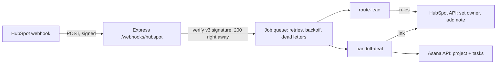

# hubspot-asana-handoff

HubSpot webhooks in, two automations out:

1. **A new contact is routed to the right salesperson.** Rules in
   `config/routing.json` look at the company's country, industry and size.
   The owner is set in HubSpot, and a note on the contact says which rule
   matched and why.
2. **A won deal is handed over to production in Asana.** When a deal moves to
   the won stage, an Asana project is created with the customer, the amount
   and the sales owner, plus the tasks in `config/handoff.json` (kick-off,
   collect assets, ...) with due dates counted from the close date. The deal
   in HubSpot gets a note with the link to the project.

```bash
npm install
npm run demo   # the whole flow against an in-memory HubSpot and Asana, no tokens
npm test       # 18 tests, offline
```

## Why

Sales lives in HubSpot and production lives in Asana. Without a link between
them, someone copies the customer details by hand when a deal is won, and
new leads wait in a shared inbox until someone decides who takes them. I
built lead routing for HubSpot before; this project rebuilds it from scratch
and adds the handoff to production.

## How it works



- `src/hubspot/signature.ts`: HubSpot's v3 signature (HMAC-SHA256 over
  method, URL, body and timestamp). Requests older than five minutes are
  rejected, so a captured request can't be replayed.
- `src/server/app.ts`: verifies, parses, queues and answers 200 at once.
  HubSpot retries slow webhooks, so the work never happens in the request.
- `src/queue/jobQueue.ts`: retries with exponential backoff. A job that
  keeps failing goes to a dead-letter list (shown on `/health`) instead of
  disappearing.
- `src/handoff/handlers.ts`: the two automations. Idempotent: HubSpot can
  send the same event twice, and a deal can be moved back and forth, but a
  deal only ever gets one project. Progress is saved after each step, so a
  retry after an Asana error continues where it stopped.
- `src/routing/rules.ts`: pure function, first matching rule wins. A rule
  that needs a fact the lead doesn't have (no employee count, say) doesn't
  match, so incomplete leads go to the fallback owner instead of being
  guessed into a segment.

## Running it for real

1. In HubSpot, create a private app with the scopes
   `crm.objects.contacts.read/write`, `crm.objects.companies.read`,
   `crm.objects.deals.read`, `crm.objects.owners.read`, and webhook
   subscriptions for `contact.creation` and `deal.propertyChange`
   (property `dealstage`).
2. In Asana, create a personal access token and find the team gid.
3. Copy `.env.example` to `.env` and fill it in. `PUBLIC_WEBHOOK_URL` must
   be the exact URL HubSpot calls, because it is part of the signature.
4. Edit `config/routing.json` (owner emails must exist as HubSpot users)
   and `config/handoff.json`.
5. `npm run build && npm start`.

## Status and limits

- Logic, signature check, queue and both clients are built and tested
  offline against fakes. **Not yet run against a live HubSpot or Asana
  account.**
- The store and the queue are in memory. Fine for one instance; on Cloud
  Run the store would move to Firestore and the queue to Cloud Tasks or
  Pub/Sub, because instances restart and scale out.
- If the sales owner isn't a member of the Asana workspace, the task is
  created unassigned with a note, instead of failing the handoff.

## Development

```bash
npm run lint
npm run typecheck
npm run build
npm test
```
